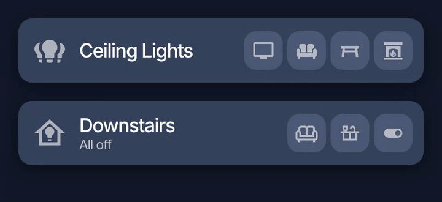
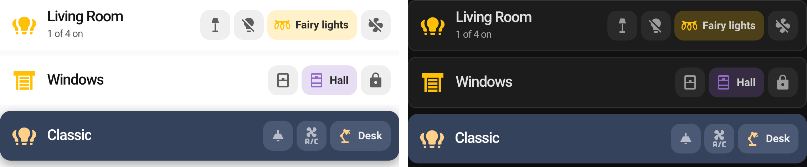

<p align="center">
  
</p>

<h1 align="center">Light Pills Card</h1>

<p align="center">
  A compact room card for Home Assistant dashboards. Each card holds 2 to 4 light pills: tap one to toggle the light, and when a light is on its pill grows to show the name. The pills size themselves to fit their label, so "TV" and "Living Room" both look right without setting any widths.
</p>

<p align="center">
  <a href="https://github.com/pqpxo/ha-light-pills-card/releases/latest"></a>
  <a href="https://www.home-assistant.io/"></a>
  <a href="https://hacs.xyz/"></a>
  <a href="LICENSE"></a>
</p>

<p align="center">
  
</p>

## Features

- 2 to 4 lights per card, each with its own entity, name, icon, tap action and hold action
- Pills grow to exactly fit their label, with a smooth animation
- Four expand modes, from "only when it's the only light on" to "always"
- Visual editor, so no YAML is needed
- Colours, radius, shadow, sizes and fonts are all configurable, and theme variables work too
- Works with `light`, `switch`, `fan` and `input_boolean` entities
- One JavaScript file with no dependencies

## Installation

### HACS

[](https://my.home-assistant.io/redirect/hacs_repository/?owner=pqpxo&repository=ha-light-pills-card&category=plugin)

Or add it by hand:

1. Open **HACS** in Home Assistant.
2. Open the three-dot menu and choose **Custom repositories**.
3. Add `https://github.com/pqpxo/ha-light-pills-card` with the type **Dashboard**.
4. Search for **Light Pills Card** and download it.
5. Refresh your browser.

### Manual

1. Download `light-pills-card.js` from the [latest release](https://github.com/pqpxo/ha-light-pills-card/releases/latest).
2. Copy it to `config/www/light-pills-card.js`.
3. Go to **Settings > Dashboards**, open the three-dot menu, choose **Resources** and add `/local/light-pills-card.js` as a **JavaScript module**.
4. Refresh your browser.

## Quick start

Edit a dashboard, add a card and search for **Light Pills**. Pick your lights in the editor and you're done.

Prefer YAML? This is all you need:

```yaml
type: custom:light-pills-card
name: Living Room
lights:
  - light.example_1
  - light.example_2
  - light.example_3
```

Listing an entity on its own uses its friendly name and icon. To set them yourself:

```yaml
type: custom:light-pills-card
name: Ceiling Lights
icon: mdi:ceiling-light
lights:
  - entity: light.example_1
    name: TV
    icon: mdi:television
  - entity: light.example_2
    name: Sofa
    icon: mdi:sofa
  - entity: light.example_3
    name: Table
    icon: mdi:table-furniture
  - entity: light.example_4
    name: Fire
    icon: mdi:fireplace
```

## Configuration

Every option below is also available in the visual editor. [`examples/all-options.yaml`](examples/all-options.yaml) has them all in one file.

### Card

| Option | Default | Description |
| --- | --- | --- |
| `name` | | Card title |
| `icon` | `mdi:lightbulb-group` | Header icon. It takes the "on" colour when any light is on |
| `image` | | Image for the header, such as `/local/bulb.png`. Replaces the icon |
| `show_icon` | `true` | Show the header icon or image |
| `show_count` | `false` | Show "1 of 3 on" under the name |
| `expand` | `single` | When pills show their name (see below) |
| `lights` | **required** | 2 to 4 lights (see below) |
| `entity` | | Entity opened by a `more-info` action on the header |
| `tap_action` | `none` | Action when tapping the name or icon |
| `hold_action` | `none` | Action when holding the name or icon |

### Expand modes

| `expand` | A pill shows its name when |
| --- | --- |
| `single` | it is on and it is the only light on |
| `on` | it is on |
| `always` | always |
| `never` | never (icons only) |

### Lights

| Option | Default | Description |
| --- | --- | --- |
| `entity` | **required** | A `light`, `switch`, `fan` or `input_boolean` entity |
| `name` | Friendly name | Text shown when the pill expands |
| `icon` | Entity icon | Pill icon |
| `tap_action` | `toggle` | Any Home Assistant [action](https://www.home-assistant.io/dashboards/actions/) |
| `hold_action` | `more-info` | Any Home Assistant action |

### Appearance

Any CSS value works. Bare numbers are read as pixels, so `border_radius: 15` is the same as `border_radius: 15px`.

| Option | Default |
| --- | --- |
| `background` | `#35425c` |
| `border_radius` | `15px` |
| `box_shadow` | `rgba(0, 0, 0, 0.35) 0px 5px 15px` |
| `border` | `none` |
| `height` | `70px` |
| `padding` | `0 12px 0 14px` |
| `name_color` | `#ffffff` |
| `name_font_size` | `21px` |
| `name_font_weight` | `500` |
| `name_letter_spacing` | `-0.9px` |
| `image_size` | `40px` |
| `pill_background` | `#4B5975` |
| `pill_background_on` | same as `pill_background` |
| `pill_text_color` | `#ffffff` |
| `pill_size` | `42px` |
| `pill_icon_size` | `24px` |
| `pill_radius` | `13px` |
| `pill_gap` | `5px` |
| `pill_font_size` | `15px` |
| `pill_font_weight` | `600` |
| `icon_color_on` | `#FFD08A` |
| `icon_color_off` | `#ffffff` |
| `icon_opacity_off` | `0.6` |
| `animation_duration` | `0.25s` |

`animation_duration` also takes a bare number. Up to 5 is read as seconds and anything larger as milliseconds.

## Examples



### Custom colours with `expand: on`

```yaml
type: custom:light-pills-card
name: Bedroom
icon: mdi:bed-outline
expand: 'on'
background: '#13274a'
border: 1px solid rgba(125, 211, 252, 0.25)
box_shadow: none
border_radius: 22
pill_radius: 21
pill_background: '#1f3a66'
pill_background_on: '#3a5a8c'
icon_color_on: '#7dd3fc'
lights:
  - entity: light.bedside
    icon: mdi:lamp
  - entity: light.hallway
    icon: mdi:wall-sconce-flat
```

### Follow your Home Assistant theme

```yaml
type: custom:light-pills-card
name: Kitchen
background: var(--ha-card-background, var(--card-background-color))
box_shadow: var(--ha-card-box-shadow, none)
name_color: var(--primary-text-color)
pill_background: var(--secondary-background-color)
pill_text_color: var(--primary-text-color)
icon_color_off: var(--primary-text-color)
icon_color_on: var(--state-light-active-color, #FFD08A)
lights:
  - light.kitchen_ceiling
  - light.kitchen_island
```

### Tap the header to turn everything off

```yaml
type: custom:light-pills-card
name: Downstairs
show_count: true
tap_action:
  action: perform-action
  perform_action: light.turn_off
  target:
    entity_id:
      - light.living_room
      - light.kitchen_island
      - light.hallway
lights:
  - light.living_room
  - light.kitchen_island
  - light.hallway
```

## Styling with CSS variables

Each appearance option is also a CSS variable: `--lpc-` followed by the option name with dashes, for example `--lpc-pill-background`. Use them in a theme to restyle every card at once, or per card with [card-mod](https://github.com/thomasloven/lovelace-card-mod):

```yaml
card_mod:
  style: |
    ha-card {
      --lpc-icon-color-on: var(--amber-color);
    }
```

## How the automatic width works

Each pill is a small two-column grid: the icon, then the label. Expanding animates the label column from `0fr` to `1fr`. Because the pill sizes itself to its content, `1fr` works out to the exact width of the text, so there's nothing to measure or hard-code and the animation stays smooth.

If the pills ever need more room than the card has, such as four long names with `expand: always` on a phone, the card name gives way first and the pill labels clip after that. Nothing spills outside the card.

## Troubleshooting

**"Custom element doesn't exist: light-pills-card"**
The browser hasn't loaded the file yet. Do a hard refresh. In the Companion app, clear the frontend cache from the app's settings. If it persists, check the resource is listed under **Settings > Dashboards > Resources** as a JavaScript module.

**Pill names never appear**
With the default `expand: single`, a name only shows while that light is the only one on. Use `expand: on` to show the name of every light that's on.

**A pill shows a question-mark bulb**
That entity doesn't exist or isn't loaded. Check the entity ID.

## Coming from button-card

This card started life as a [button-card](https://github.com/custom-cards/button-card) design, and its defaults reproduce that look. [`examples/ceiling-lights.yaml`](examples/ceiling-lights.yaml) shows the conversion: the original 629 lines of YAML come down to 16, with no helper sensor and no per-pill pixel widths.

## Development

There's no build step. The card is `dist/light-pills-card.js`.

```bash
npm install                     # icons for the local preview
python3 -m http.server 8765     # then open http://localhost:8765/dev/preview.html
python3 dev/test_preview.py     # headless checks (Playwright with Chromium)
python3 dev/record_demo.py      # regenerate docs/demo.gif (needs ffmpeg)
python3 dev/build_logo.py       # regenerate docs/logo.svg and docs/logo.png (needs Inter Display)
```

The preview page stubs the few Home Assistant elements the card uses, so you can work on it without a running instance.

### Releasing

1. Bump `VERSION` in `dist/light-pills-card.js` and `version` in `package.json`.
2. Merge to `main`.
3. Publish a GitHub release tagged `vX.Y.Z`. The release workflow checks the tag matches `VERSION` and attaches the card file for HACS.

## Contributing

Issues and pull requests are welcome. Please run `python3 dev/test_preview.py` before opening a PR, and include a screenshot or GIF for visual changes.

## Licence

[MIT](LICENSE)
